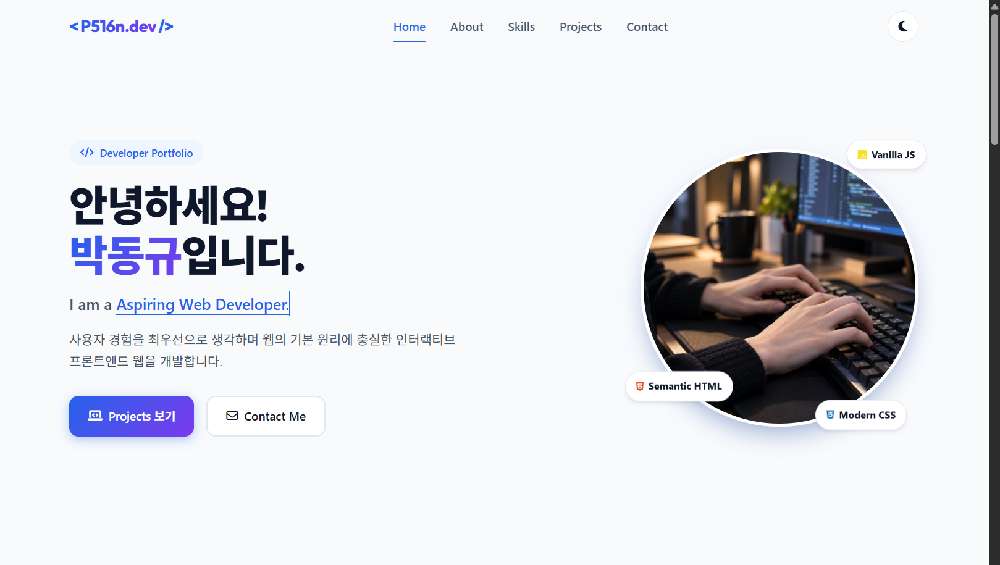
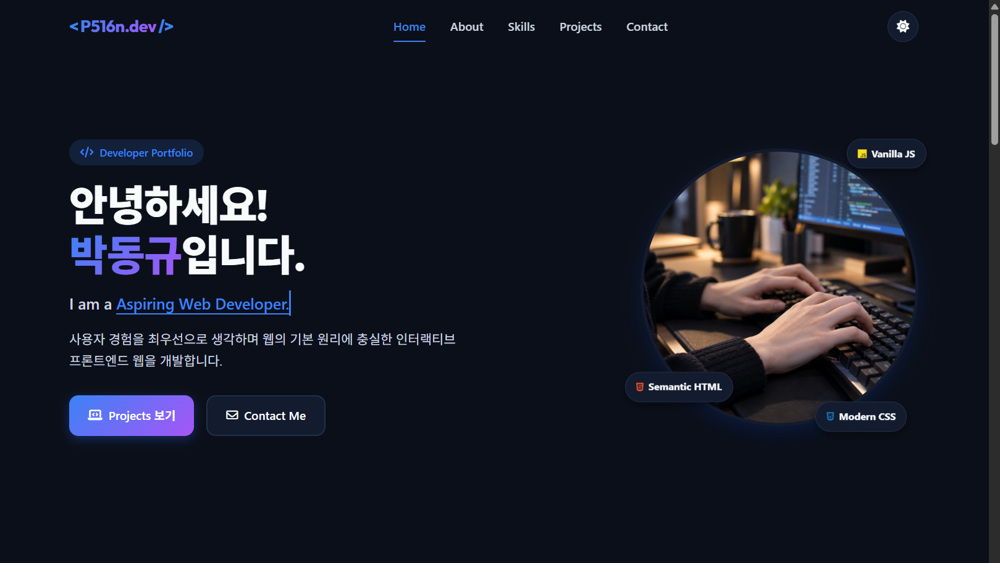
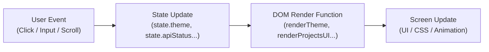

# 🚀 Codyssey-B1-1: Responsive Developer Portfolio

> **외부 프레임워크나 라이브러리 없이 순수 HTML5, CSS3, Vanilla JavaScript(ES6+)만으로 구현한 반응형 개발자 포트폴리오 웹사이트입니다.**  
> 웹의 핵심 기본 원리인 **"사용자 이벤트 → 상태(State) 변경 → DOM 업데이트"** 흐름을 기반으로 견고한 아키텍처와 인터랙티브 사용자 경험(UX)을 제공합니다.

---

## 🌐 배포 및 저장소 링크

- **🌐 Live Demo (GitHub Pages)**: [https://p516n.github.io/Codyssey-B1-1/](https://p516n.github.io/Codyssey-B1-1/)
- **💻 GitHub Repository**: [https://github.com/P516n/Codyssey-B1-1](https://github.com/P516n/Codyssey-B1-1)

---

## 📸 미리보기 (Preview)

| 데스크톱 라이트 모드 (Desktop Light) | 데스크톱 다크 모드 (Desktop Dark) |
| :---: | :---: |
|  |  |

| 모바일 반응형 뷰 (Mobile Responsive) | 햄버거 메뉴 & GitHub API 카드 |
| :---: | :---: |
| *768px 미만 디바이스 최적화* | *동적 필터링 및 4-State UI* |

> *※ 실제 구동 화면은 상단 배포 링크(Live Demo)를 통해 직접 체험하실 수 있습니다.*

---

## 🛠️ 기술 스택 (Tech Stack)

| 구분 | 사용 기술 | 설명 |
| :--- | :--- | :--- |
| **Markup** | **HTML5** | W3C 웹 표준 준수, 시맨틱 태그 구조화, 웹 접근성(a11y, ARIA) 및 SEO 최적화 |
| **Styling** | **CSS3** | 모바일 퍼스트(Mobile-First), CSS 변수(`:root`), Flexbox & CSS Grid, 부드러운 트랜지션 |
| **Scripting** | **Vanilla JavaScript (ES6+)** | 외부 의존성 0%, DOM API, `async/await`, Fetch API, Intersection Observer, LocalStorage |
| **Assets & Fonts** | Google Fonts, Font Awesome | Pretendard, Outfit 폰트 및 Font Awesome 6.5.1 벡터 아이콘 활용 |
| **Deployment** | GitHub Pages | 정적 웹 호스팅 및 지속적 배포 |

> **⚠️ 순수 웹 표준 지향:** React, Vue, jQuery, Bootstrap, Tailwind CSS 등 외부 라이브러리/프레임워크를 전혀 사용하지 않고 바닐라 코드로만 작성되었습니다.

---

## ✨ 핵심 기능 (Key Features)

### 1. 📱 반응형 레이아웃 (Mobile-First Responsive Web)
- **모바일 퍼스트(Mobile-First) 설계**: 작은 모바일 뷰포트 스타일을 기본으로 작성하고 미디어 쿼리를 통해 태블릿/데스크톱 레이아웃을 점진적으로 확장
- **브레이크포인트**:
  - **모바일**: 기본 (~767px)
  - **태블릿**: `768px` 이상 (`@media (min-width: 768px)`)
  - **데스크톱**: `1024px` 이상 (`@media (min-width: 1024px)`)
- **Flexbox & Grid의 적재적소 분리**:
  - **Flexbox**: 네비게이션 바(로고-메뉴-액션 정렬), 히어로 버튼 그룹, 소셜 링크, 필터 버튼 목록 등 1차원 선형 배치
  - **CSS Grid**: Projects 섹션(`repeat(auto-fit, minmax(280px, 1fr))`), Skills 카드 그리드, About 소개 영역 등 2차원 공간 배치

### 2. 🌓 다크 모드 테마 시스템 (Dark Mode & Persistence)
- **CSS 변수 기반 디자인 토큰**: `:root`와 `[data-theme="dark"]` 셀렉터에 색상·배경·그림자 변수를 정의하여 테마 변경 시 전역 일괄 반영
- **설정 영구 저장 (`localStorage`)**: 새로고침이나 재방문 시에도 사용자가 선택한 테마(`portfolio_theme`) 유지
- **OS 시스템 테마 자동 감지**:
  - `window.matchMedia('(prefers-color-scheme: dark)')`를 조회하여 초기 방문 시 사용자 OS 환경에 맞춤 설정
  - OS 테마가 실시간 변경될 경우 이벤트 리스너를 통해 즉시 반응

### 3. 🐙 GitHub REST API 연동 & 4가지 UI 상태 (4-State UI)
- `fetch` 및 `async/await` 비동기 통신을 통해 실제 GitHub 저장소 목록(`https://api.github.com/users/{username}/repos`)을 동적으로 렌더링
- 사용자 경험을 극대화하는 **4단계 UI 상태 처리**:
  1. **로딩 상태 (Loading)**: 데이터를 요청하는 동안 로딩 스피너와 상태 메시지 표시
  2. **성공 상태 (Success)**: 저장소 이름, 설명, 별점(Stars), 사용 언어, GitHub 링크, 라이브 데모 링크를 담은 카드 그리드 출력
  3. **에러 상태 (Error)**: 네트워크 오류 및 GitHub API 레이트 리밋(시간당 60회 초과, 403 오류) 발생 시 안내 문구와 함께 **"다시 시도"** 버튼 제공
  4. **빈 데이터 상태 (Empty)**: 공개 저장소가 없거나 필터 조건에 맞는 프로젝트가 없을 때 안내 메시지 노출
- **언어별 프로젝트 동적 필터링**:
  - 불러온 저장소 데이터에서 사용 언어를 자동 추출(`new Set()`)하여 필터 탭 동적 생성
  - 고차 배열 메서드(`Array.prototype.filter`, `map`)를 활용한 실시간 클라이언트 필터링

### 4. 🎯 인터랙티브 UX 및 스크롤 이벤트 (Scroll Interactions)
- **모바일 햄버거 메뉴 토글**:
  - 터치 디바이스에서 햄버거 버튼 클릭 시 네비게이션 드롭다운 메뉴 토글
  - 메뉴 외부 영역 클릭 시 자동 닫힘 및 메뉴 링크 선택 시 자동 닫힘 처리
  - 웹 접근성을 위해 `aria-expanded` 속성 실시간 동기화
- **부드러운 스크롤 (Smooth Scroll) & 활성 섹션 하이라이트**:
  - 네비게이션 링크 클릭 시 해당 섹션으로 부드럽게 이동
  - 현재 뷰포트에 위치한 섹션을 감지하여 네비게이션 메뉴에 `active` 클래스 자동 갱신
- **스크롤 탑 버튼 (Scroll-to-Top)**:
  - 스크롤을 내리면 우측 하단에 부드럽게 나타나며, 클릭 시 최상단으로 스크롤 이동
- **스크롤 애니메이션 (Intersection Observer API)**:
  - 뷰포트에 섹션 및 요소가 진입할 때 자연스러운 페이드인/슬라이드업 트랜지션 실행
  - 1회 노출 후 `unobserve`하여 불필요한 브라우저 리소스 낭비 방지
- **히어로 타이핑 효과 (Typewriter Effect)**:
  - 바닐라 자바스크립트로 구현된 한 글자씩 타이핑 및 삭제되는 무한 루프 애니메이션

### 5. 📝 Contact 폼 유효성 검사 (Form Validation UX)
- **실시간 피드백 (`input` 이벤트)**: 사용자가 오류 필드를 올바르게 수정하는 즉시 인라인 에러 메시지 제거
- **제출 검증 (`submit` 이벤트)**:
  - `event.preventDefault()`로 페이지 새로고침 방지
  - 이름 필수 입력 검증
  - 정규식을 활용한 이메일 포맷 검증 (`/^[^\s@]+@[^\s@]+\.[^\s@]+$/`)
  - 메시지 최소 글자 수(5자 이상) 검증
- **UX 및 접근성**:
  - 유효성 검증 실패 시 오류가 발생한 첫 번째 입력창으로 자동 포커스(`focus()`)
  - 검증 성공 시 폼 초기화 및 상단 성공 알림 배너 노출 (일정 시간 후 자동 소멸)

---

## 📏 주요 인터랙션 설정값 (Threshold Specifications)

> 본 프로젝트의 스크롤 및 애니메이션 임계값은 요구사항에 맞춰 `js/config.js`를 통해 중앙 집중 관리되며, 설정값은 다음과 같습니다:

| 항목 | 설정값 | 코드 위치 | 설명 |
| :--- | :---: | :--- | :--- |
| **네비게이션 배경 전환** | **`60px`** | `CONFIG.SCROLL.NAVBAR_THRESHOLD` | 스크롤 60px 이상 시 헤더에 블러 및 배경색 스타일(`.scrolled`) 적용 |
| **스크롤 탑 버튼 노출** | **`300px`** | `CONFIG.SCROLL.TOP_BTN_THRESHOLD` | 스크롤 300px 이상 시 우측 하단 맨 위로 가기 버튼(`.visible`) 표시 |
| **스크롤 애니메이션 임계값** | **`0.2`** | `CONFIG.SCROLL.INTERSECTION_THRESHOLD` | `IntersectionObserver`의 `threshold: 0.2`로 요소가 20% 이상 노출될 때 진입 애니메이션 실행 |

---

## 🔄 상태 관리 아키텍처 (State-Driven Architecture)

본 프로젝트는 React, Vue와 같은 최신 프론트엔드 프레임워크의 근간이 되는 **"사용자 이벤트 → 상태 변경 → DOM 렌더링"** 단방향 데이터 흐름을 바닐라 자바스크립트로 명확하게 구현했습니다.



### 대표적인 상태-렌더링 파이프라인
1. **테마 전환**:
   `버튼 클릭 이벤트` ➔ `state.theme` 토글 및 `localStorage` 갱신 ➔ `renderTheme()` 실행 ➔ `document.documentElement[data-theme]` 변경 및 아이콘 교체
2. **GitHub API 데이터 조회**:
   `페이지 로드 / 재시도 클릭` ➔ `state.apiStatus = 'loading'` ➔ 스피너 렌더링 ➔ 비동기 `fetch` 성공 시 `state.repos` 저장 및 `state.apiStatus = 'success'` ➔ 카드 그리드 렌더링
3. **프로젝트 필터링**:
   `필터 버튼 클릭` ➔ `state.selectedFilter` 갱신 ➔ `Array.filter()`로 `state.filteredRepos` 갱신 ➔ `renderProjectsUI()` 실행
4. **폼 유효성 검사**:
   `입력 및 제출 이벤트` ➔ 필드 유효성 평가 ➔ 에러 메시지 요소 텍스트 갱신 및 입력창 `.input-error` 클래스 제어

---

## 📂 디렉토리 구조 (Directory Structure)

```plaintext
Codyssey-B1-1/
├── index.html            # 메인 HTML5 시맨틱 문서
├── README.md             # 프로젝트 명세 및 문서
├── LICENSE               # 오픈소스 라이선스 (MIT)
├── css/
│   └── style.css         # 전역 스타일, CSS 변수, Flex/Grid 레이아웃, 미디어 쿼리
├── js/
│   ├── config.js         # 사용자 프로필 정보 및 스크롤 임계값 설정 파일
│   └── main.js           # 상태 관리, DOM 조작, 이벤트 리스너, 비동기 API 통신 로직
└── images/
    ├── favicon.svg       # 브라우저 탭 파비콘
    └── profile.png       # 히어로 및 About 섹션 프로필 이미지
```

---

## 🚀 시작하기 및 개인화 설정 (Getting Started)

### 1. 로컬 개발 환경 실행
별도의 빌드 도구나 Node.js 환경 없이 브라우저에서 바로 실행할 수 있습니다.
1. 저장소를 클론합니다:
   ```bash
   git clone https://github.com/P516n/Codyssey-B1-1.git
   cd Codyssey-B1-1
   ```
2. VS Code에서 폴더를 연 후, **Live Server** 확장 프로그램을 사용하여 `index.html`을 실행합니다. (또는 브라우저로 `index.html`을 직접 실행)

### 2. 개인 정보 및 설정 변경 (`js/config.js`)
`js/config.js` 파일에서 본인의 정보와 GitHub 계정을 입력하면 사이트 전체에 자동 반영됩니다:

```javascript
const CONFIG = {
  // 본인의 GitHub 유저네임 (API 연동)
  GITHUB_USERNAME: 'P516n',

  // 프로필 정보
  PROFILE: {
    name: '홍길동',
    title: 'Frontend Developer',
    typingTexts: [
      'Frontend Developer.',
      'Creative Problem Solver.',
      'Continuous Learner.'
    ],
    email: 'your-email@example.com',
    githubUrl: 'https://github.com/your-id',
    linkedinUrl: 'https://linkedin.com/in/your-id'
  },

  // 인터랙션 임계값 설정
  SCROLL: {
    NAVBAR_THRESHOLD: 60,       // 네비게이션 스타일 변경 스크롤 (px)
    TOP_BTN_THRESHOLD: 300,     // 탑 버튼 노출 스크롤 (px)
    INTERSECTION_THRESHOLD: 0.2 // 스크롤 애니메이션 진입 임계값 (0.0 ~ 1.0)
  }
};
```

---

## 💡 설계 및 기술적 의사결정 Q&A (Technical Reflection)

### Q1. HTML, CSS, JavaScript를 파일별로 분리한 이유와 역할은 무엇인가요?
- **관심사의 분리(Separation of Concerns)** 원칙을 준수했습니다.
  - **HTML (`index.html`)**: 콘텐츠의 구조와 시맨틱 정보만을 담아 접근성과 검색 엔진 최적화(SEO)를 담당합니다.
  - **CSS (`css/style.css`)**: 브라우저 렌더링에 필요한 시각적 표현(레이아웃, 색상, 타이포그래피, 테마 토큰)을 담당합니다.
  - **JavaScript (`js/main.js`, `js/config.js`)**: 데이터 처리, 비동기 네트워크 통신, 사용자 인터랙션 및 상태 기반 동적 DOM 렌더링을 담당합니다.
- 파일을 분리함으로써 코드의 가독성과 재사용성을 높이고, 브라우저 캐싱을 활용해 초기 로딩 성능을 최적화할 수 있습니다.

### Q2. 시맨틱 태그는 어떤 기준으로 선택했나요?
- 무분별한 `<div>` 사용을 지양하고, 브라우저와 스크린 리더가 문서의 구조를 올바르게 파악할 수 있도록 표준 시맨틱 태그를 적용했습니다.
  - `<header>` / `<nav>`: 상단 네비게이션 및 사이트 브랜딩 영역 명시
  - `<main>`: 페이지의 중심 콘텐츠 영역 그룹화
  - `<section>`: Hero, About, Skills, Projects, Contact 등 고유한 주제를 가진 콘텐츠 구역 구분
  - `<article>`: 개별 기술 스택 카드와 GitHub 프로젝트 카드 등 독립적으로 배포/재사용 가능한 콘텐츠 단위 표현
  - `<footer>`: 저작권 정보 및 외부 소셜 링크 명시

### Q3. CSS 변수(`:root`)로 테마를 관리할 때의 이점은 무엇인가요?
- 색상, 폰트 패밀리, 그림자 값 등의 디자인 시스템 토큰을 한 곳에서 중앙 관리할 수 있어 유지보수 비용이 대폭 감소합니다.
- `[data-theme="dark"]` 가상 선택자 하위에 동일한 변수명으로 다크 모드 색상을 오버라이드함으로써, 수백 줄의 개별 선택자를 다시 쓸 필요 없이 단 한 번의 속성 변경(`html[data-theme="dark"]`)으로 전체 UI 테마를 즉각 전환할 수 있습니다.

### Q4. 인라인 이벤트(`onclick`) 대신 `addEventListener`를 채택한 이유는 무엇인가요?
- **HTML과 JS의 결합도 분리**: 마크업 내부에 JavaScript 코드가 섞이지 않아 구조가 깔끔해집니다.
- **다중 리스너 등록 가능**: 하나의 DOM 요소에 여러 개의 독립적인 이벤트 리스너를 안전하게 바인딩할 수 있습니다.
- **이벤트 캡처링/버블링 제어**: 이벤트 흐름 제어 및 `passive: true`와 같은 최신 성능 최적화 옵션을 적용할 수 있습니다.

### Q5. 상태를 전역 `state` 객체로 집중 관리한 이유는 무엇인가요?
- 산발적인 전역 변수 대신 단일 `state` 객체에 상태(Theme, Repos, Filter, ApiStatus 등)를 모아 관리함으로써, 애플리케이션의 현재 상태를 한눈에 파악하고 예측 가능(Predictable)하게 만들 수 있습니다.
- "상태 변경"과 "화면 렌더링"을 명확히 분리함으로써, 디버깅이 쉬워지고 향후 React와 같은 상태 기반 컴포넌트 프레임워크로 전환할 때의 사고방식을 자연스럽게 체득할 수 있습니다.

### Q6. 모바일 퍼스트(Mobile-First) 방식을 채택한 이유는 무엇인가요?
- 모바일 환경의 제한된 뷰포트와 네트워크 환경을 최우선으로 고려하여 핵심 콘텐츠와 필수 스타일에 집중할 수 있습니다.
- `min-width` 미디어 쿼리를 사용함으로써 브라우저가 기본 모바일 스타일을 먼저 가볍게 로딩한 뒤 큰 화면으로 점진적 향상(Progressive Enhancement)을 적용하여 렌더링 성능과 확장성을 극대화합니다.